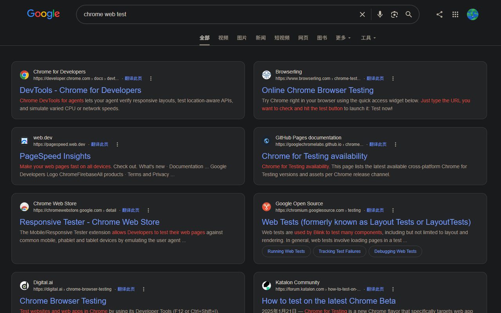

# SearchLayout

Chrome 扩展：把 **Google、Bing、DuckDuckGo 和百度的桌面网页搜索结果**排成更易读的单列或双列，并支持自动翻页。



[English](./README.en.md) · [隐私政策](./PRIVACY.md)

## 功能

- **一键预设**：简洁 / 专注阅读 / 极简干扰，调整卡片密度、列宽和各类内容的显示方式。布局在主界面独立设置，自动翻页、翻页参数和结果打开方式在「高级」中独立设置。
- **本页隐藏域名**：在弹窗「高级 → 本页隐藏域名」中输入 `pinterest.com`、`zhihu.com` 等域名并应用，过滤范围包括子域名和追加的结果。点「恢复全部」即可清除当前页的过滤规则。
- **特殊结果折叠**：「大家还在问」（People Also Ask）、视频轮播、精选摘要分别开关，可就地展开，关闭后恢复原节点；仅处理已识别结构
- **列模式**：原始 / 单列 / 单列居中 / 双列（结果以卡片形式排列）
- **AI 摘要布局**：单列居中和双列模式将识别到的 Google AI 概览、Bing Copilot 答案、DuckDuckGo Search Assist 和百度 AI 回答卡片在页面中居中
- **自动翻页**：滚到底部时，在同一页接上下一页的自然结果。开启时隐藏原生页码，关闭后恢复手动分页
- **DuckDuckGo**：有「更多结果」按钮时，自动翻页沿用扩展的批次设置。网站开启自己的无限滚动时，加载由网站控制
- **百度**：支持四种布局和自动翻页。居中模式会对齐搜索框、主导航和筛选栏。调整布局时隐藏已识别的相关搜索模块
- **加载状态**：显示已追加页数；失败后可点击重试；每追加 10 页暂停，可点击继续加载，并提供返回顶部按钮
- **偏好即时生效**：点工具栏图标即可切换；设置保存在 `chrome.storage`，可随 Chrome 账号同步
- **阅读外观**：紧凑 / 舒适 / 宽松；最大单列宽度可设为 320–1600px，留空使用自动宽度，双列时分别限制每列
- **内容显示**：分别控制 Google 知识卡侧栏、Bing 侧栏和 Google AI 概览
- **广告呈现**：已识别的顶／底广告保持原样、折叠或弱化；折叠可展开，切回原样会恢复原节点，全程在本地处理
- **翻页参数**：每批 1–50 页，距底部 0–3000px 触发；可选择每批暂停或接近底部时自动继续
- **结果打开方式**：自然结果标题可保持引擎默认、当前标签、新标签或后台标签打开；后两者保留结果页，组合键／中键仍遵循浏览器行为
- **相关搜索固定条**：将已识别的相关查询复制到底部常驻条，窄屏可横向滚动，原相关搜索保留
- **站点强化**：统一显示域名，优先复用结果已有的站点图标，再尝试目标站自己的 HTTPS `/favicon.ico`。两种图标均不可用时显示首字母。
- **已访问弱化**：通过 CSS 调淡已访问链接；新标签／后台标签创建成功后，补充当前结果页的「已打开」标记。仅保留当前页内存记录，刷新或重建会话后清除，不读取浏览历史或增加 `history` 权限；创建标签不代表目标页已成功加载

默认：单列居中 + 自动翻页开启。

打开方式默认保持引擎行为；固定相关搜索、站点强化与已访问弱化默认关闭，在弹窗「高级 → 结果与导航」中开启。打开方式只接管自然结果标题，不改广告、导航或相关查询。后台开标签使用扩展后台脚本，不需要新增 `tabs` 权限。相关条只读取已识别的 Google／Bing 相关搜索容器，没有相关查询时不显示。

域名隐藏与特殊模块折叠均通过本地 DOM 完成，不新增请求或权限，也不阻止引擎自身加载。域名规则和隐藏数量仅保留在内存，通过弹窗与当前搜索页之间的本地消息读写，刷新、搜索导航或会话释放后清除，不写入 `chrome.storage`、不同步、不上传。弹窗中的外观与折叠开关仍按原有机制保存，开启 Chrome 同步时可能同步。三类特殊块默认不折叠，未识别的结构保持原样。

新增选项默认保持卡片布局的原有效果：舒适密度、自动宽度、Google 侧栏和 AI 显示、Bing 侧栏隐藏、广告原样；每批 10 页、触发距离 800px、批次结束暂停。旧设置会自动补齐默认值。侧栏、AI 和广告显示与列模式独立，包括原始模式；侧栏／AI 仅控制显示，不阻止搜索引擎自身请求。广告只处理明确的引擎广告标记，不通过文案猜测，不删除自然结果。未识别的新结构保持原样。

## 适用范围

仅桌面版**网页搜索结果页**：

| 引擎 | 说明                                                        |
| ---- | ----------------------------------------------------------- |
| 谷歌 | `google.com` / `www.google.com` 及常见地区域名的 `/search*` |
| 必应 | `www.bing.com` / `cn.bing.com` 的 `/search*`                |
| DuckDuckGo | `duckduckgo.com` 带查询词的根路径 |
| 百度 | `baidu.com` / `www.baidu.com` 的 `/s` |

不支持：图片 / 视频 / 资讯 / 地图等垂类、手机版页面、搜索首页或结果落地页。

## 安装（开发加载）

1. 安装依赖并构建：

```bash
npm ci
npm run build
```

2. 打开 Chrome → `chrome://extensions`
3. 开启「开发者模式」
4. 「加载已解压的扩展程序」→ 选择本仓库的 `extension` 或 `dist` 目录

修改源码后重新执行 `npm run build`，再在扩展页点击刷新。

首次安装后，点开扩展弹窗即可查看快速上手。「一键开启双列并预览」会切换为双列，并打开 Bing 示例搜索。「跳过」会直接进入设置。完成状态仅保存在当前浏览器，扩展更新不会触发引导。

## 开发

仓库开发约定与验收要求见 [AGENTS.md](AGENTS.md)。

| 命令            | 说明                                                      |
| --------------- | --------------------------------------------------------- |
| `npm run build` | 用 esbuild 打包 `content.js` / `popup.js` / `background.js`，并产出 `dist/` |
| `npm test`      | 运行 Node 内置测试（linkedom）                            |
| `npm run lint` | ESLint 检查源码、脚本与测试 |
| `npm run sync` | 同步版本、内容脚本域名和 CSS 布局常量 |
| `npm run test:browser` | 本机 Chromium 布局回归 |
| `npm run test:live` | 真实页面验证，先构建；可能被搜索引擎验证页面阻断 |

开发环境要求 Node.js 24+。`npm test` 自动发现 `test/` 下所有 `*.test.mjs`，浏览器测试单独运行。

`extension/manifest.json` 的版本号为唯一来源，发版只修改这里；运行 `npm run sync` 或 `npm run build` 后提交同步的 `package.json` 与 `package-lock.json`。域名权限统一维护在 `src/search-hosts.mjs`，布局尺寸统一维护在 `src/layout-constants.mjs`，构建时同步 manifest 与 CSS 生成区。状态条与弹窗共用 `uiLocale`，切换语言后即时更新。

PR 与推送通过 GitHub Actions 执行 lint、单元测试、构建和生成文件一致性检查。浏览器及真实页面检查可在 Actions 手动运行时勾选。

主要目录：

```text
src/                 # 源码（content / popup / session / boot…）
  boot.mjs           # 会话、偏好、语言与 dispose 装配
  shell-layout.mjs   # 结果壳、列宽与侧栏布局
  nav-chrome.mjs     # 顶栏与导航对齐
  search-field.mjs   # 搜索框对齐及还原
  bing-layout.mjs    # Bing 事实行与侧栏处理
  dom-watch.mjs      # 观察器、静默改写与滚动监听
  layout-dom.mjs     # 共用 DOM 几何操作
  content-boot.mjs   # 旧导入路径的兼容导出
extension/           # 可加载的扩展目录（manifest、样式、图标、构建产物）
test/                # 测试
scripts/build.mjs    # 构建脚本
PRIVACY.md           # 隐私政策
```

## 权限说明

- `storage`：保存布局与自动翻页偏好
- 内容脚本在匹配的 Google、Bing、DuckDuckGo 和百度网页搜索结果页生效。百度首页的脚本用于检测站内首次搜索跳转。

扩展**不会**把搜索词或页面内容上传到开发者服务器。详见 [PRIVACY.md](./PRIVACY.md)。

## License

[MIT](./LICENSE)
